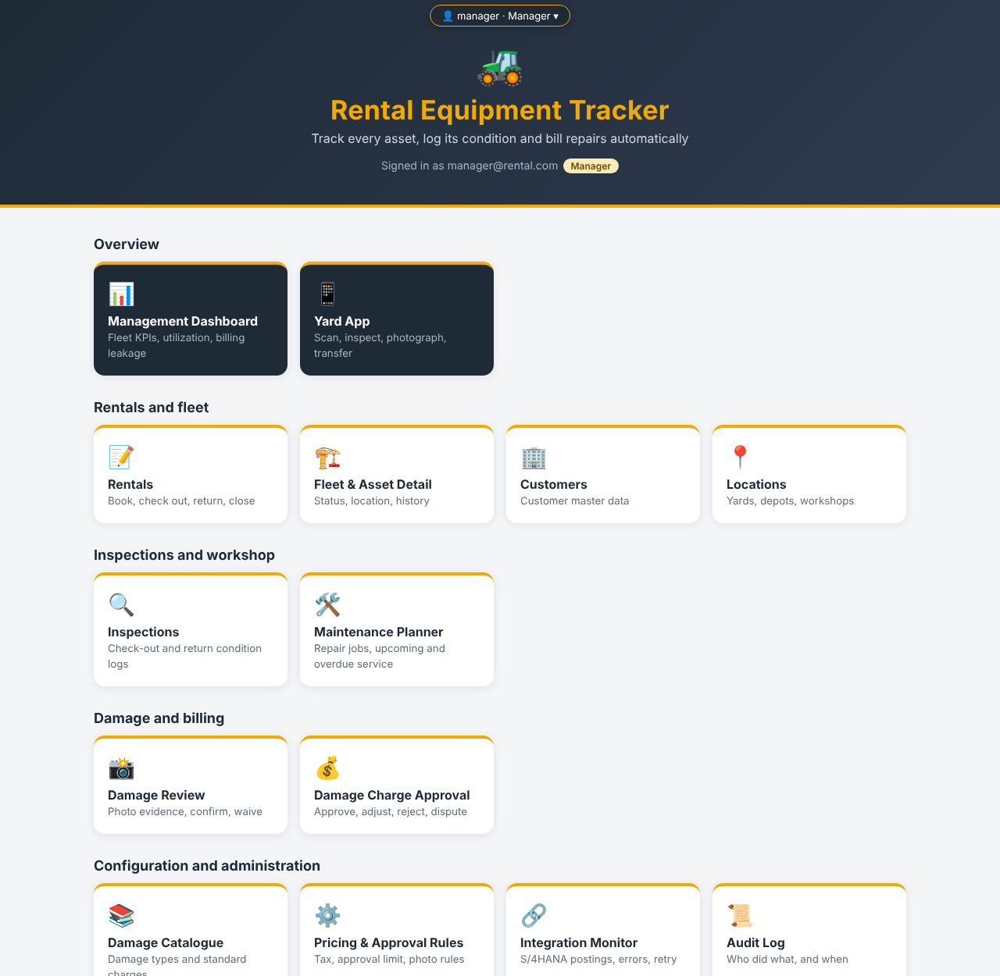
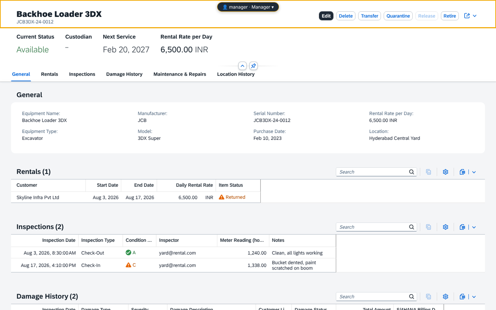
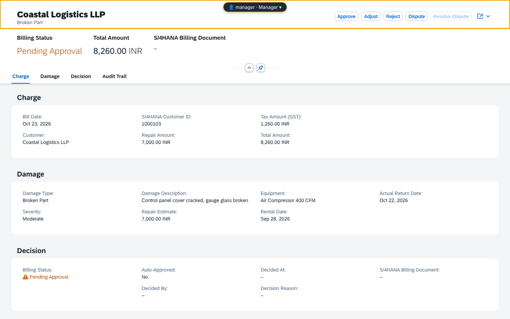
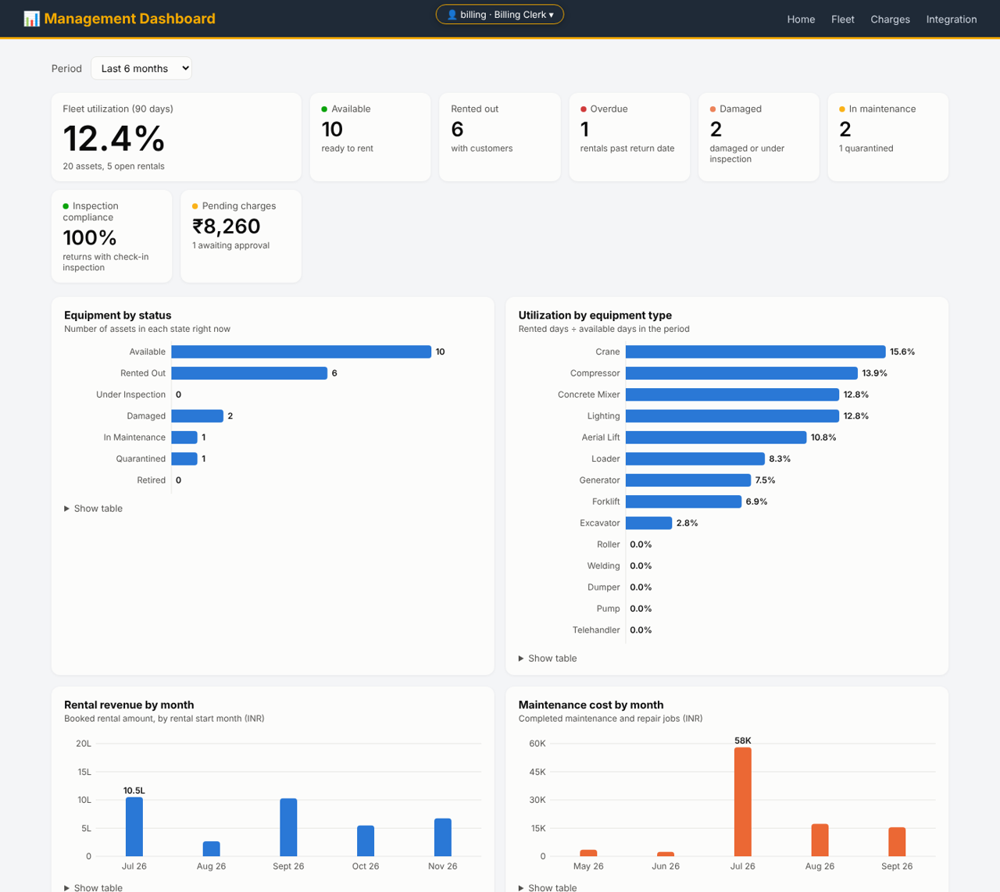
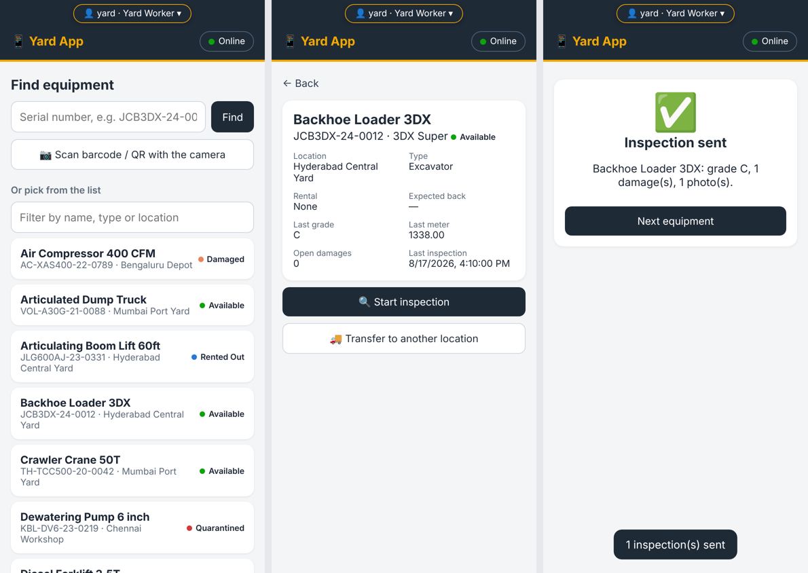

# Rental Equipment Tracker

Rental Equipment Tracking & Condition Logging with Automated Repair Billing, built with the
SAP Cloud Application Programming Model (CAP, Node.js), SAP Fiori elements and SAP HANA Cloud,
for SAP Business Application Studio (BAS).

The project implements the functional requirement document *"Rental Equipment Tracking & Condition
Logging – HANA Integration" (v1.0)* and its ER diagram: every asset has one trusted record
(status, location, custodian, maintenance and condition history); return inspections are
standardised with photo evidence and an A–D condition grade; repair charges are calculated,
approved and posted to SAP S/4HANA through an outbox.



## Project layout

It follows the recommended CAP layout (same structure as the reference project):

File or Folder | Purpose
---------|----------
`db/schema.cds` | domain model: the 10 entities of the ER diagram plus supporting tables
`db/data/` | configuration data deployed everywhere (settings, damage catalogue, dropdown values)
`srv/` | service definitions (`*.cds`) and handlers (`*.js`)
`srv/lib/` | shared business logic (pricing engine, status matrix, outbox, S/4HANA client, ...)
`app/annotations/` | Fiori elements annotations (labels, value helps, list/object pages)
`app/<name>/` | 12 Fiori elements apps (List Report + Object Page, generated layout of SAP Fiori tools)
`app/landing`, `app/dashboard`, `app/yard`, `app/switch` | landing page, management dashboard, yard (mobile) app, test-login switch
`test/` | Jest tests and demo data (`test/data`, development and tests only)
`scripts/makeSampleData.js` | regenerates the CSV data (`npm run sample-data`)
`mta.yaml`, `xs-security.json`, `.deploy/app-router` | deployment to SAP BTP Cloud Foundry
`srv/requests.http` | ready-made requests for the REST Client, one per role and business step

## Data model (ER diagram)

| Entity | Key fields (from the FRD) | Extra fields for the requirements |
|---|---|---|
| Customers | companyName, contactPerson, email, phone, address, s4CustomerId | – |
| Rentals | customer, rentalDate, expectedReturnDate, actualReturnDate, rentalStatus, totalRentalAmount | `isOverdue`, `overdueDays` (computed, FR-009) |
| RentalItems | rental, equipment, dailyRentalRate, startDate, endDate, itemStatus | `rentalDays`, `lineAmount` (computed) |
| Equipment | location, equipmentName, equipmentType, manufacturer, model, serialNumber, purchaseDate, rentalRatePerDay, currentStatus | `nextServiceDate`, `custodian` (computed) |
| Locations | locationName, locationType, address, city, latitude, longitude | `equipmentCount` (computed) |
| MaintenanceRecords | equipment, maintenanceType, maintenanceDate, description, serviceProvider, cost, nextMaintenanceDate, status | `isOverdue` (computed) |
| ConditionLogs | equipment, rental, inspectionDate, inspectionType, conditionGrade, inspectorName, meterReading, notes | `clientRef` (offline-sync key) |
| DamageRecords | conditionLog, damageType, damageDescription, severity, repairEstimate, customerLiable, damageStatus | `liabilityNote` |
| DamagePhotos | damage, fileName, mediaType, photoContent (LargeBinary), uploadedAt, uploadedBy | `sha256Hash`, `storageUrl` |
| RepairBills | rental, customer, damage, billDate, repairAmount, taxAmount, totalAmount, billingStatus, s4BillingDocumentId | approval fields (`decisionBy/At/Reason`, `autoApproved`) |

Supporting tables: `RentalStatusHistory` (FR-008), `RepairBillHistory` (approval audit trail),
`LocationTransfers` (FR-011), `DamageCatalogue` and `Settings` (configuration), `OutboxMessages`
(Integration Monitor), `AuditLog` (all write actions), `CodeLists` (dropdown values) and the view
`DamageHistory` (FR-020).

## Services

| Service | Path | Entities / actions | Who |
|---|---|---|---|
| RentalManagementService | `/odata/v4/rental` | Customers, Rentals (+items, history), Equipment, Locations; `checkOut`, `returnRental`, `closeRental`, `cancelRental`, `transferLocation`, `quarantine`, `releaseQuarantine`, `retireEquipment`, `checkAvailability()` | authenticated user, writes per role |
| MaintenanceManagementService | `/odata/v4/maintenance` | MaintenanceRecords, ConditionLogs (+damages, photos); `startWork`, `completeWork`, `cancelWork`, `getUpcomingMaintenance()`, `getOverdueMaintenance()`, `getInspectionHistory()` | maintenance team, inspectors |
| DamageManagementService | `/odata/v4/damage` | DamageRecords, DamagePhotos (`@Core.MediaType`), RepairBills; `confirmDamage`, `waiveDamage`, `closeDamage`, `generateBill`, `approveCharge`, `adjustCharge`, `rejectCharge`, `disputeCharge`, `resolveDispute`, `calculateCharge()`, `getDamageHistory()` | inspectors, billing, managers |
| AdminService | `/odata/v4/admin` | DamageCatalogue, Settings, OutboxMessages (`retry`), AuditLog; `processOutbox`, `syncBillingStatus` | admin, manager, auditor, billing |
| AnalyticsService | `/odata/v4/analytics` | `getFleetKPIs`, `getUtilization`, `getRentalTrend`, `getMaintenanceCosts`, `getMaintenanceCostByEquipment`, `getBillingSummary`, `getChargesByStatus`, `getTopDamageCategories`, `getOverdueRentals`, `getServiceSchedule` | dashboard roles |
| MobileService (REST) | `/rest/mobile` | `scanEquipment`, `submitInspection` (offline, idempotent), `uploadPhoto` (base64 + SHA-256), `transferEquipment`; read-only Equipment, Locations, OpenRentalItems, CodeLists – **no price data** | yard roles |
| SessionService | `/odata/v4/session` | `me()` – user and roles for the landing page | everyone |

### Libraries (`srv/lib`)

| File | What it does |
|---|---|
| `common.js` | roles, audit log, status history, settings, price hiding for YardWorker, Fiori criticality |
| `status-matrix.js` | allowed status transitions for rentals, equipment, damages, bills, maintenance |
| `pricing.js` | rental amounts and repair charges: estimate → damage catalogue → severity factor, GST, auto-approval limit |
| `inspection.js` | inspection rules (grade A–D, meter reading never lower, rental check), pre-existing damage detection, equipment status after inspection |
| `billing.js` | confirm damage → repair job + maintenance notification + repair bill (auto-approved below the limit) |
| `outbox.js` | outbox with idempotency key, retry (max 5 attempts), masked payload |
| `s4-client.js` | S/4HANA calls through the destination (`API_MAINTNOTIFICATION`, `API_DEBIT_MEMO_REQUEST_SRV`, `API_BILLING_DOCUMENT_SRV`); simulated by default |
| `photos.js` | photo type and size checks, SHA-256 evidence hash, optional Cloudinary copy |
| `equipment.js` | location transfer with history, equipment status changes |
| `cloudinary.js` | Cloudinary upload / signed URL (optional, as in the reference project) |

## The seven roles

Defined in `xs-security.json` (role collections `RET_<Role>`) and as mocked users for local testing:

| Role | Test login | Can do |
|---|---|---|
| YardWorker | `yard@rental.com` / `yard` | scan, inspect, photograph, transfer – **price data is hidden** |
| Dispatcher | `dispatch@rental.com` / `dispatch` | customers, rentals, check-out (override with reason), return |
| Technician | `tech@rental.com` / `tech` | repair jobs, confirm damages, release quarantine |
| BillingClerk | `billing@rental.com` / `billing` | approve, adjust, reject, dispute charges; integration monitor |
| Manager | `manager@rental.com` / `manager` | all approvals, overrides, waive damages, dashboards |
| Admin | `admin@rental.com` / `admin` | configuration (catalogue, pricing rules), master data, outbox |
| Auditor | `auditor@rental.com` / `auditor` | read-only access to everything, audit log |

Authorization is enforced in CAP with `@requires` (service level) and `@restrict` (entity and
action level). Saved inspections are immutable, photo evidence cannot be swapped (hash check),
and every write is logged in `AuditLog`.

## Fiori apps

| App | Entity | FRD screen |
|---|---|---|
| `ret.rental.equipment` | Equipment | Fleet Overview list + Asset Detail (status, custodian, next service; rentals, inspections, damage, repairs, location history) |
| `ret.rental.rentals` | Rentals | rental contracts, check-out / return / close |
| `ret.rental.customers`, `ret.rental.locations` | Customers, Locations | master data |
| `ret.maintenance.inspections` | ConditionLogs | inspections with damages and photos |
| `ret.maintenance.maintenance` | MaintenanceRecords | Maintenance Planner and Repair Jobs |
| `ret.damage.damages` | DamageRecords | Inspection Review: photo evidence, confirm, waive |
| `ret.damage.repairbills` | RepairBills | Damage Charge Approval: Approve / Adjust / Reject / Dispute |
| `ret.admin.catalogue`, `ret.admin.settings` | DamageCatalogue, Settings | Configuration |
| `ret.admin.integration` | OutboxMessages | Integration Monitor (status, masked payload, retry) |
| `ret.admin.auditlog` | AuditLog | audit trail |

Plus `/dashboard` (Management Dashboard: utilization, overdue, billing leakage, maintenance cost)
and `/yard` (mobile web app with camera, offline queue and SHA-256 photo hashes).

| | |
|---|---|
|  |  |
|  |  |

## Run it in SAP Business Application Studio

1. Open a terminal in the project folder and install everything (root and app workspaces):
   ```sh
   npm install
   ```
2. Start the app with an in-memory SQLite database and the demo data:
   ```sh
   cds watch
   ```
3. Open `http://localhost:4004/switch/index.html`, pick one of the seven test logins, and you land
   on the role-based start page. Every Fiori app runs at `/<app>/webapp/index.html` (for example
   `/equipment/webapp/index.html`) and has its own script, e.g. `npm run watch-equipment`.
4. Run the tests:
   ```sh
   npm test
   ```

`srv/requests.http` walks through the whole process (book → inspect → check out → return late →
damage with photo → confirm → approve → post to S/4HANA) with the right user for every step.

## SAP HANA Cloud and SAP HANA Database Explorer

The production profile uses SAP HANA Cloud (`@cap-js/hana`). To work against your HANA database from BAS:

1. Log in to Cloud Foundry: `cf login` (or *View → Find Command → CF: Login to Cloud Foundry*).
2. Create the HDI container once:
   ```sh
   cf create-service hana hdi-shared rental-equipment-tracker-db
   ```
3. Deploy the tables, views and data (configuration **and** demo data, because this is not a production build):
   ```sh
   npm run deploy:hana
   ```
   This runs `cds deploy --to hana:rental-equipment-tracker-db`.
4. Bind the container once and run the app against SAP HANA instead of SQLite:
   ```sh
   cds bind -2 rental-equipment-tracker-db
   npm run hybrid
   ```
5. Open the **SAP HANA Database Explorer** in BAS, add a database connection to the HDI container
   `rental-equipment-tracker-db` and browse the tables `RET_CUSTOMERS`, `RET_EQUIPMENT`, `RET_RENTALS`,
   `RET_CONDITIONLOGS`, `RET_DAMAGERECORDS`, `RET_DAMAGEPHOTOS`, `RET_REPAIRBILLS`, ... For example:
   ```sql
   SELECT E.EQUIPMENTNAME, E.SERIALNUMBER, E.CURRENTSTATUS, L.LOCATIONNAME
     FROM RET_EQUIPMENT E JOIN RET_LOCATIONS L ON L.ID = E.LOCATION_ID
    ORDER BY E.CURRENTSTATUS;

   SELECT BILLINGSTATUS, COUNT(*) AS BILLS, SUM(TOTALAMOUNT) AS AMOUNT
     FROM RET_REPAIRBILLS GROUP BY BILLINGSTATUS;
   ```

## Deploy to SAP BTP (Cloud Foundry)

```sh
mbt build
cf deploy mta_archives/rental-equipment-tracker_1.0.0.mtar
```

The MTA creates the HDI container, XSUAA (with the 7 role templates), the destination service and
the HTML5 repository; `scripts/copyUi.js` puts the Fiori apps and pages into the service module, so
the approuter (XSUAA login) serves them at the same paths as locally. Afterwards assign the role collections `RET_YardWorker`, `RET_Dispatcher`,
`RET_Technician`, `RET_BillingClerk`, `RET_Manager`, `RET_Admin`, `RET_Auditor` to users in the
BTP cockpit. The production build deploys only configuration data (`db/data`); demo data stays in
`test/data`.

### S/4HANA integration

Postings (maintenance notification INT-04, debit memo request INT-06, billing status INT-07) are
written to the outbox first and sent by a worker every minute (`OUTBOX_INTERVAL_SEC`, 0 = off) or with
*Process Now* in the Integration Monitor. They go through the destination `HANA_DEV` / `HANA_QAS` /
`HANA_PROD` (profile-dependent, see `cds.requires.HANA_S4` in `package.json`).
`"simulate": true` answers the calls locally so the flow works without a backend; set it to `false`
once the destinations exist. `S4_SIMULATE_OUTAGE=true` simulates a backend outage (messages fail and are retried).

### Cloudinary (optional)

As in the reference project, photos can also be copied to Cloudinary. Create a `.env` file locally
(`CLOUDINARY_CLOUD_NAME`, `CLOUDINARY_API_KEY`, `CLOUDINARY_API_SECRET`) or a user-provided service
`cloudinary-credentials` on BTP and uncomment it in `mta.yaml`. Without it, photos are stored only in
SAP HANA (`DamagePhotos.photoContent`).

## Requirement coverage

| FRD | Where |
|---|---|
| FR-001 – FR-004, FR-022 | Customers, Rentals with items (overlap check), Equipment; `@cds.search` |
| FR-005, FR-014, FR-015 | ConditionLogs (Fiori + yard app), grade A–D validated (`@assert.range` + dropdown) |
| FR-006, FR-016, FR-017, FR-021 | DamageRecords, liability rules (pre-existing damage is not billed), status matrix, catalogue estimates |
| FR-007, FR-025 | pricing engine, RepairBills approval flow, billing reports |
| FR-008, FR-009 | RentalStatusHistory, `overdueDays` / `isOverdue`, late days charged on return |
| FR-010, FR-011 | Locations, `transferLocation` + LocationTransfers |
| FR-012, FR-013, FR-024 | MaintenanceRecords, planner functions, maintenance cost reports |
| FR-018, FR-019, FR-020 | DamagePhotos (media stream, SHA-256, uploader, time), DamageHistory |
| FR-023 | AnalyticsService + dashboard (utilization, revenue, KPIs) |

Not in this release (as in the FRD out-of-scope list or left open there): native Android/iOS app
(a mobile web app is included instead), plant-based instance restrictions, DIM document storage,
Event Mesh, and AI damage detection. The Fleet Overview and Management Dashboard analytical list pages
are delivered as the HTML dashboard, the same way the reference project does it.

## Learn more

Learn more at <https://cap.cloud.sap>.
